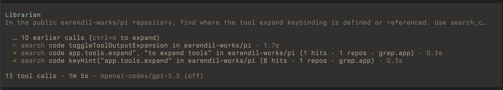
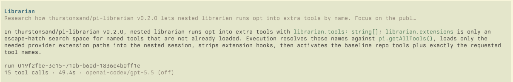
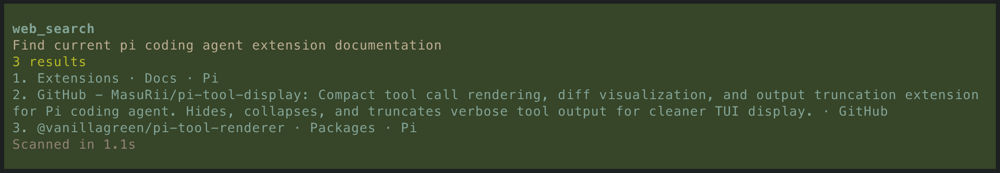
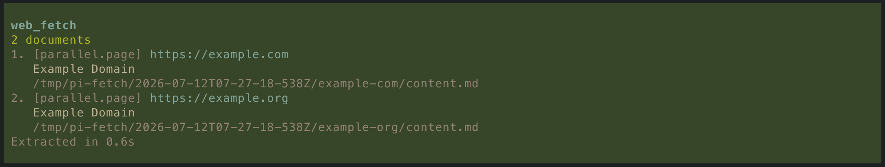

# pi-librarian

A code research subagent for the [pi coding agent](https://github.com/badlogic/pi-mono) inspired by [Amp](https://ampcode.com/): deep-dive questions about specific repos ("how does drizzle-orm implement prepared statements?") and discovery across the ecosystem ("compare the most popular TypeScript SQL ORMs"). It also gives your session, and every librarian run, `web_search` and `web_fetch`.





## How it works

The `librarian` tool spawns a research subagent with purpose-built tools, built from the sources you configure. One tool per search engine, because every engine's query language and filters differ; a tool with no configured instance does not appear, and one with several takes a `source` argument naming which.

- **`checkout_repo`** — clone into a local cache, where it can be read locally, and `git log -S`/`blame`/`diff` covers history. Takes a repository path plus a `source` naming one of your configured sources, or a full HTTPS/SSH clone URL on its own.
- **`read_file`** — read one file or list one directory from a code host without cloning.
- **`search_code_github`** — GitHub code search over public code and private repositories your token can read.
- **`search_code_grepapp`** — public code search via [Grep](https://grep.app/), with regex.
- **`search_repos_github`** — GitHub repository discovery by name, topics, language, stars, and activity.
- **`search_code_gitlab`**, **`search_repos_gitlab`** — with a declared GitLab: exact-string code search within a project (across projects with `advancedSearch`), held to GitLab's 30 code searches a minute, and project search by name, group, topic, and activity.
- **`search_code_bitbucket`**, **`search_repos_bitbucket`** — with a declared Bitbucket Server: whole-word code search across every repository, and repository search by the start of a name.
- **`search_code_sourcegraph`**, **`search_repos_sourcegraph`**, **`find_definition`** — with a declared Sourcegraph: code search across every repository it indexes, with a `detail` of repos, files, or matched lines and a statement of whether it covered them all; repository search by name, topic, contained path, or recent commits; and symbol definitions by exact name, leaving vendored copies out unless asked.

- **`web_search`**, **`web_fetch`** — the [web tools](#web-tools), which librarian runs get as well.

Every search returns a short digest, 10 results unless the librarian asks for up to 50, and writes the full result set to a file it can grep. A search that runs past its 15-second budget is an error that says how to narrow it, never a partial answer.

## Usage

- Ask pi a question involving other repos; it asks the `librarian`.
- Ask follow-up questions to earlier librarian runs.
- `/librarian` attaches the research tools directly to your session for direct tool usage.
- `web_search` and `web_fetch` are always in your session; `/browser open` opens the fetch browser so you can log in to sites it should reach.

## Web tools

This package absorbed [pi-web-tools](https://github.com/thurstonsand/pi-web-tools), which is deprecated. Uninstall it: both register `web_search` and `web_fetch`, and pi reports the clash at startup.

### `web_search`

Backed by [Parallel](https://parallel.ai/), and registered only when a Parallel key is configured. It takes an objective and returns results with excerpts.



Parameters:

- `objective` (required) — what you want to learn.
- `search_queries` — up to 8 specific queries.
- `max_results` — 1–8, defaults to 5.
- `after_date` — `YYYY-MM-DD` freshness filter.

### `web_fetch`



Fetch up to 10 URLs at once. Each document's body is written under `<cacheDir>/fetches/<call>/` as a native artifact (markdown, patch, source file), and the tool result is a digest: title, facts, the artifact paths with sizes, and a capped excerpt. Pass an optional `objective` to steer extraction where supported.

Each URL goes through a chain of fetchers, `github → parallel → local`; the first to produce a document wins.

**GitHub** resolves URLs on github.com and on any `github` source you declare, through the same client and token as the repo tools:

- Repository READMEs, files (including `blob` and `raw` URLs), and directories as a listing
- Issues, pull requests, and Discussions with their conversations; PRs also carry the diff. An issue carries its timeline filtered to closes, reopens, and references, and says when a commit closed it, because closed as `completed` alone can mean the reporter was answered rather than the bug fixed.
- Issue and PR listings, `github.com/{owner}/{repo}/issues` or `/pulls`, optionally with `?q=` in GitHub search syntax, up to 100 matches, each with its state and reason
- Commits with metadata, comments, and a patch; commit history, optionally scoped by ref and path, up to 100 commits
- Releases (tagged, latest, and listings), tags, and branches
- GitHub Actions runs with jobs, steps, and artifact metadata

**Parallel** extracts anything else, when a key is configured.

**Local** is a browser fallback: [`playwright-core`](https://github.com/microsoft/playwright) driving your Chrome, with a [rehype](https://github.com/rehypejs/rehype) HTML-to-markdown pipeline. It reaches pages behind a login once you have logged in through `/browser open`, and downloads non-HTML files such as PDFs. A bot-wall challenge that does not clear headless within `headlessWaitSecs` briefly opens a visible window for up to `headedWaitSecs`, unless `escalation` is `"never"`. `/browser restart` applies changed browser settings.

## GitHub auth for private repos

Public GitHub reads work without configuration. To let the librarian search and read private GitHub repositories, provide a token in one of these ways:

1. Set `GITHUB_TOKEN` or `GH_TOKEN` in the environment before starting pi.
2. Or authenticate the GitHub CLI so `gh auth token` returns a token:

The token is loaded once per pi session and used for GitHub access in `search_code_github`, `search_repos_github`, `read_file`, and `web_fetch`. For private repositories, use a token with read access to the target repos. `checkout_repo` uses git's built-in credential helpers instead.

## Configuration

In pi's global `settings.json`:

```jsonc
{
  "librarian": {
    "model": "openai-codex/gpt-5.5",
    "thinkingLevel": "off",
    "tools": { "disabled": [] },
    "sources": [
      {
        "name": "example-gl",
        "url": "https://gitlab.example.com",
        "kind": "gitlab",
        "tokenEnv": "EXAMPLE_GITLAB_TOKEN",
        "advancedSearch": false,
        "description": "Holds the services not yet migrated to example-bb.",
      },
      {
        "name": "example-bb",
        "url": "https://git.example.com",
        "kind": "bitbucket-server",
        "disabled": ["code-search"],
      },
      {
        "name": "example-sg",
        "url": "https://search.example.com",
        "kind": "sourcegraph",
      },
    ],
    "builtInSources": { "github": true, "gitlab.com": false },
    "search": { "timeoutSeconds": 15, "defaultLimit": 10 },
    "web": {
      "parallel": { "apiKeyCommand": "op read op://Private/Parallel/credential" },
      "fetch": {
        "browser": { "executablePath": "/Applications/Google Chrome.app/Contents/MacOS/Google Chrome" },
        "challenge": { "escalation": "headed", "headlessWaitSecs": 10, "headedWaitSecs": 20 },
      },
    },
    "cacheDir": "/tmp/pi-librarian",
    "debug": { "persistRuns": false },
  },
}
```

| Setting             | Recommended                                      | Default                        |
| ------------------- | ------------------------------------------------ | ------------------------------ |
| `model`             | `openai-codex/gpt-5.5`                           | current session model          |
| `thinkingLevel`     | `off`                                            | current session thinking level |
| `tools.disabled`    | names of tools to remove from librarian runs     | `[]`                           |
| `sources`           | code hosts and search backends                   | `[]`                           |
| `builtInSources`    | switch `github` and `gitlab.com` on or off       | `github` on, `gitlab.com` off  |
| `search.timeoutSeconds` | seconds a search may run before it is an error | `15`                        |
| `search.defaultLimit` | results a search returns unless asked for more (at most 50) | `10`              |
| `web.parallel.apiKeyCommand` | shell command printing a Parallel key, run per call | `PARALLEL_API_KEY` only |
| `web.fetch.browser.executablePath` | the Chrome the local fetcher drives | an installed Chrome    |
| `web.fetch.browser.profileDir` | the fetch browser's profile          | `~/.pi/agent/browser-profile`  |
| `web.fetch.challenge.*` | `escalation` (`headed` or `never`), `headlessWaitSecs`, `headedWaitSecs` | `headed`, `10`, `20` |
| `cacheDir`          | `/tmp/pi-librarian`                              | `/tmp/pi-librarian`            |
| `debug.persistRuns` | persist nested session file paths for debugging  | `false`                        |

Each `librarian.sources` entry requires a unique `name`, an HTTPS `url`, and a `kind`: `github`, `gitlab`, `bitbucket-server`, or `sourcegraph`. The `kind` decides which roles a source can play — `clone`, `code-search`, `repo-search` — unless `disabled`. `github` and `gitlab.com` are built in and need no entry; `builtInSources` switches each on or off as a whole, and a switched-off source does not exist at all, though a full clone URL to its host still clones.

Search needs an API token; cloning does not, because it uses git's own credentials. A source reads its token from the environment variable named by `tokenEnv`, or by default from its kind's usual variable: `GITHUB_TOKEN`/`GH_TOKEN`, `GITLAB_ACCESS_TOKEN`, `BITBUCKET_TOKEN`, `SRC_ACCESS_TOKEN`. A source without a token keeps cloning and loses its search tools. `advancedSearch: true`, on a `gitlab` source only, says the instance has GitLab's advanced search, which lets code search span projects. `description` is up to 300 characters the agent cannot discover for itself, such as what a Sourcegraph does not index; it ends the description of every tool that reaches that source, so attached tools carry it too. Note that `librarian.tools.disabled` is a different lever: it removes a tool from the run entirely, where a source's `disabled` removes one source from one role.

Every key under `librarian` is checked, and an unknown one is an error rather than ignored. Librarian runs have `read`, `grep`, `find`, `ls`, `bash`, the research tools, and the web tools; never `write` or `edit`.

## Development

```bash
npm run check                       # biome + tsc + vitest
pi -e ./extensions/librarian.ts     # run pi with this extension loaded
```
